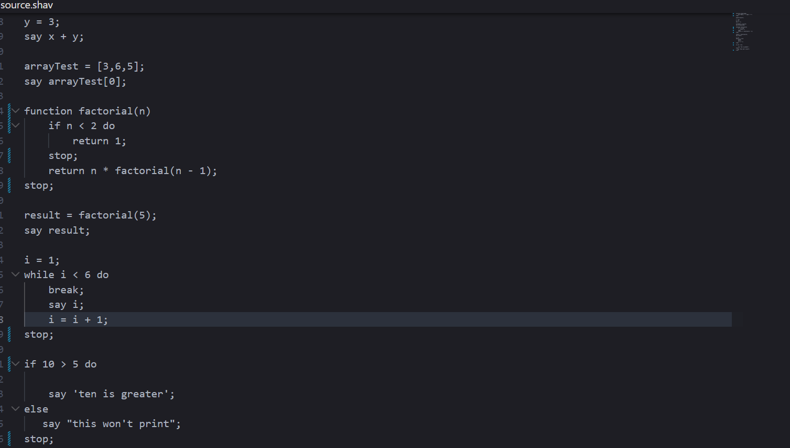

# ShavenScript

- A lightweight programming langauge that supports variables,arrays and basic control structures.
- Built in Rust using the LALRPOP parser
- Created following the programming language module in resolution-rust.

### AI Declaration - Copilot was used for explaining the rust ownership model and syntax errors.

## Features

- Arrays with indexing
- While loop with break
- Support for both single quotes and double quotes
- Custome file extension

## Run Project

### Prerequisites - Cargo, Rust

- cargo install shavenscript
- cargo run <name-of-file-to-be-run>

## Cloning

- Prerequsites - Rust
- git clone https://github.com/Shaven-Wickramanayaka/shavenscript.git
- cd shavenscript
- cargo run

